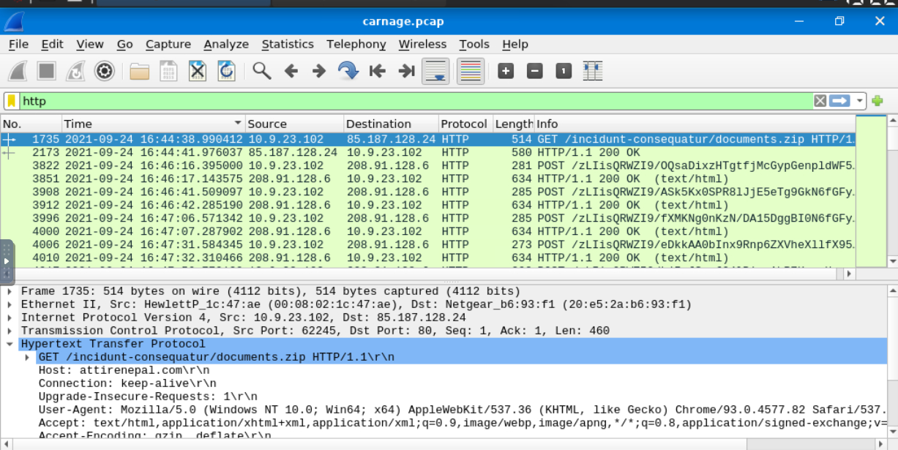
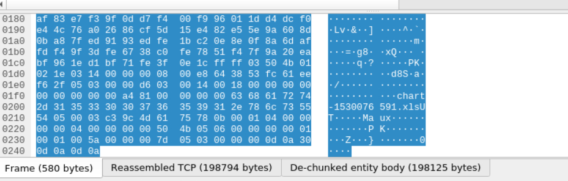
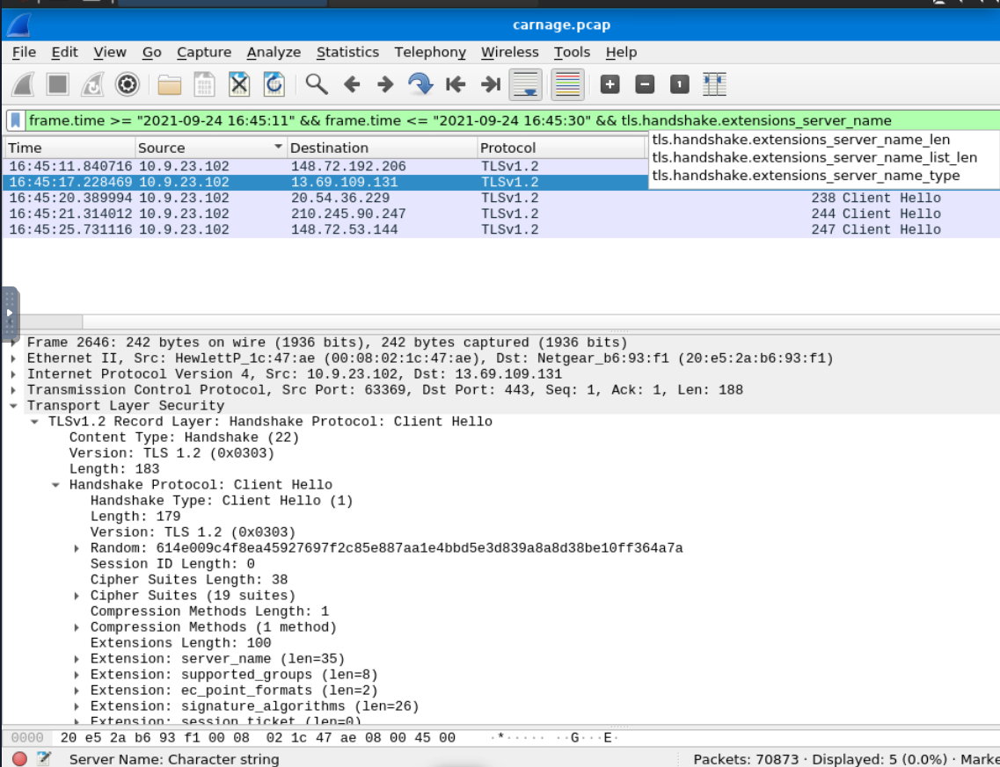
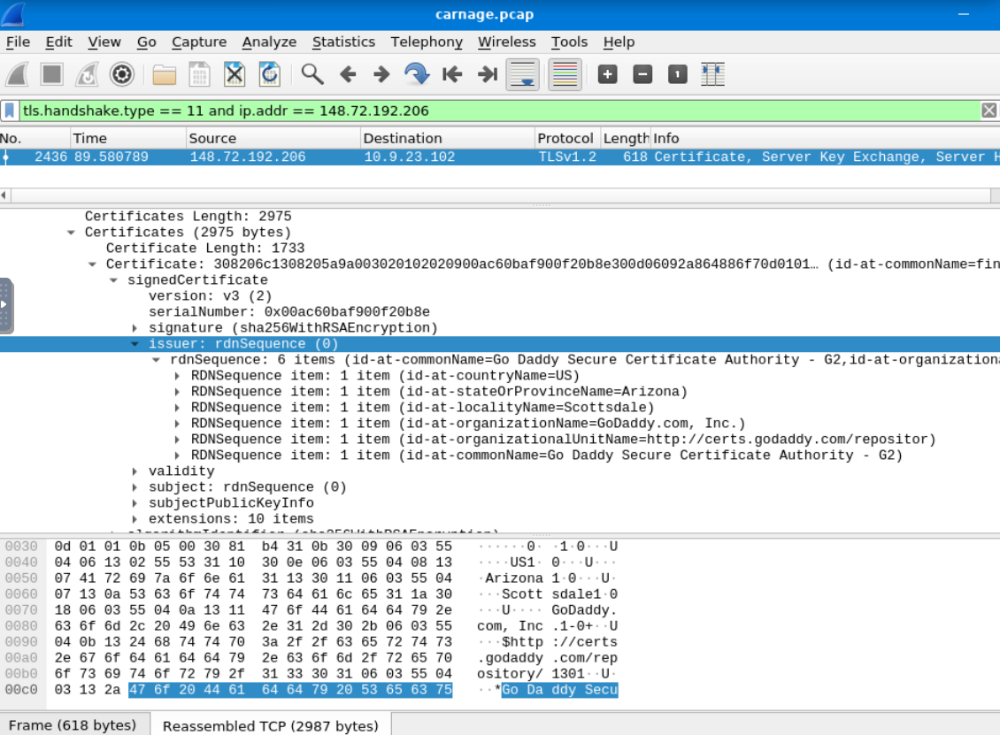
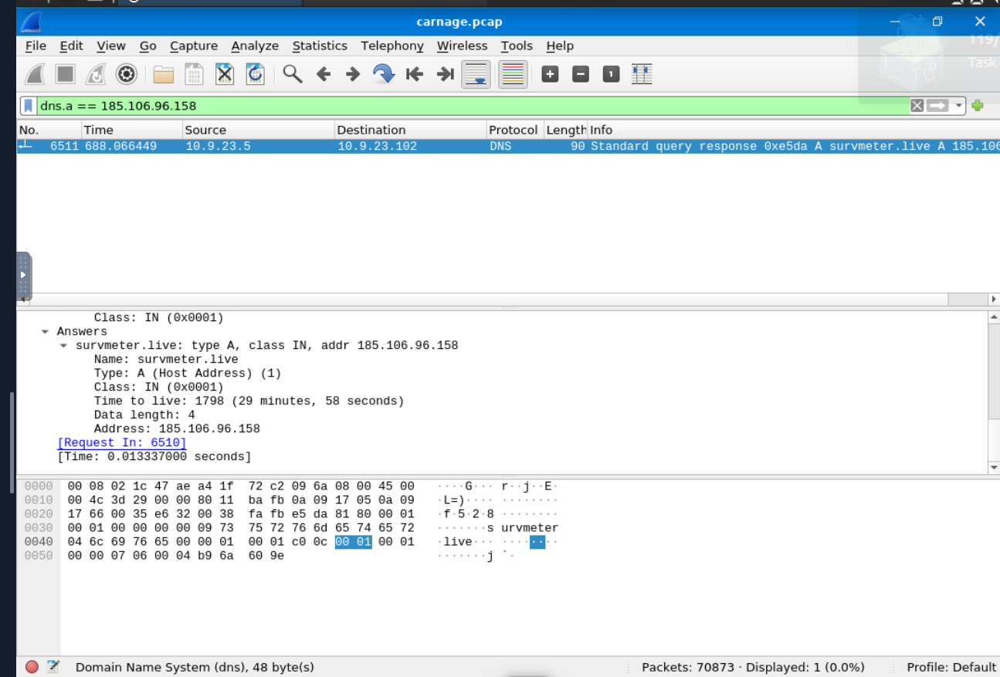
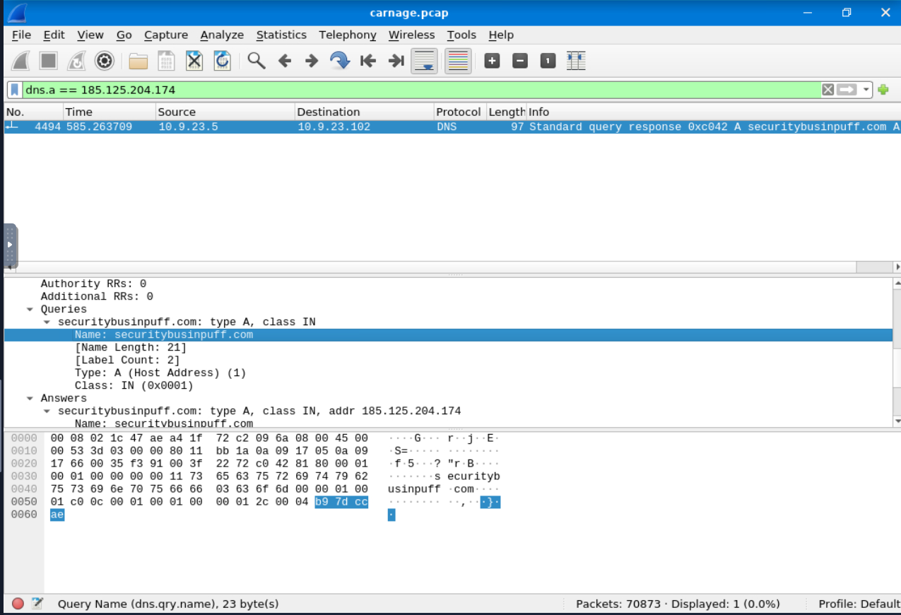
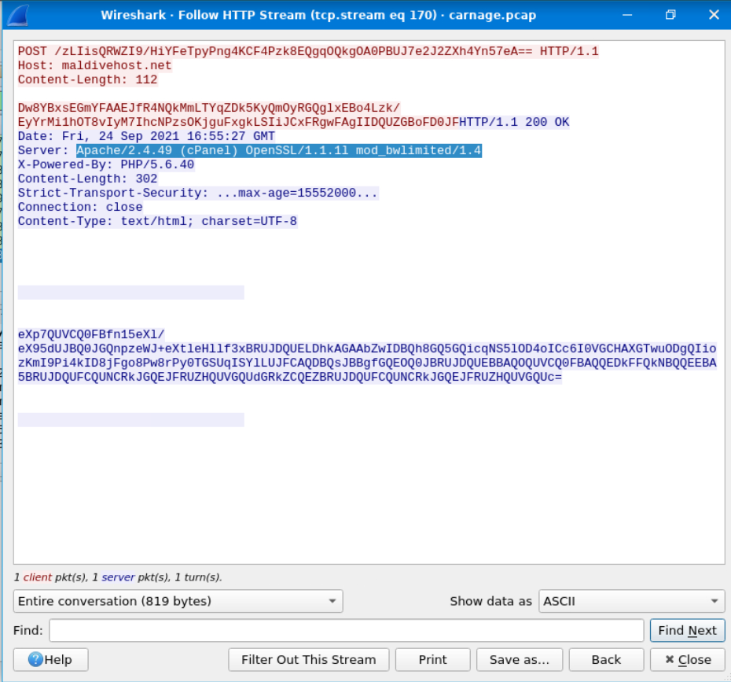
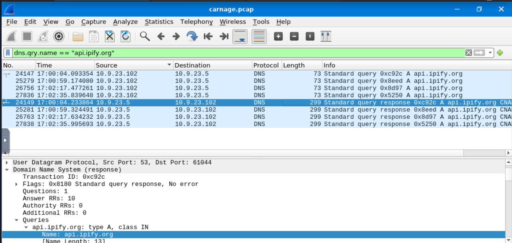
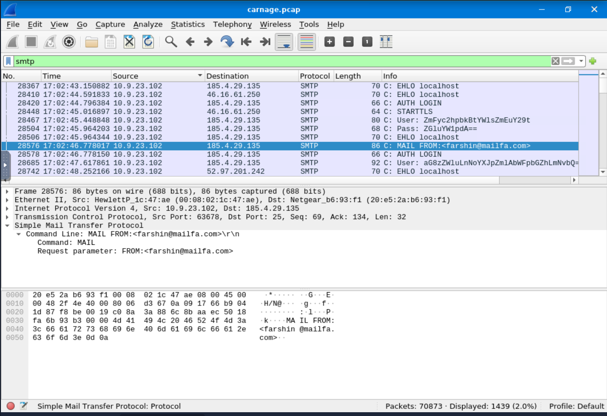

# Carnage — Malicious Document & Cobalt Strike Investigation

**Investigation Type:** Network / PCAP Analysis  
**Environment:** TryHackMe controlled training lab  
**Tools:** Wireshark, VirusTotal  
**Primary Skills:** HTTP analysis, TLS/SNI, DNS pivots, C2 identification, SMTP analysis, incident timeline reconstruction

## Scenario

A Purchasing Department employee received a Word document from a known contact and enabled active content. Endpoint monitoring subsequently detected suspicious outbound connections from the workstation. A packet capture from the network sensor was provided for investigation.

**Victim host:** `10.9.23.102`

## Executive Summary

Analysis of the packet capture identified a malicious download chain followed by additional encrypted payload activity, Cobalt Strike command-and-control infrastructure, post-infection HTTP communication, public-IP discovery, and SMTP activity.

The investigation began with the first suspicious HTTP download and then pivoted across HTTP streams, DNS records, TLS Server Name Indication (SNI), certificate metadata, network conversations, and external threat intelligence to reconstruct the activity.

## Investigation

### 1. Initial Payload Delivery

The first suspicious HTTP request from the victim retrieved `documents.zip` from `attirenepal.com`.

```text
Victim:       10.9.23.102
Destination:  85.187.128.24
Domain:       attirenepal.com
File:         documents.zip
Time:         2021-09-24 16:44:38 UTC
```

Inspection of the reassembled ZIP data in Wireshark exposed the embedded filename `chart-1530076591.xls` without executing the payload.





### 2. Identifying Encrypted Download Infrastructure

Because subsequent downloads used HTTPS, the HTTP request paths were not directly visible. I narrowed the activity to the relevant timeframe and inspected TLS Client Hello packets containing Server Name Indication.

Representative filter:

```text
frame.time >= "2021-09-24 16:45:11" &&
frame.time <= "2021-09-24 16:45:30" &&
tls.handshake.extensions_server_name
```

This identified three domains involved in the suspicious encrypted activity:

- `finejewels.com.au`
- `thietbiagt.com`
- `new.americold.com`



Certificate inspection for the first domain showed a GoDaddy-issued certificate. A legitimate certificate authority does not establish that the content hosted by a domain is safe.



### 3. Cobalt Strike Command-and-Control

Wireshark conversation analysis was used to identify unusual external communication from the victim. Two IP addresses were investigated further and validated with threat-intelligence data as Cobalt Strike infrastructure:

```text
185.106.96.158
185.125.204.174
```

DNS A-record pivots connected the infrastructure to:

```text
185.106.96.158   -> survmeter.live
185.125.204.174  -> securitybusinpuff.com
```

Example pivot:

```text
dns.a == 185.106.96.158
```





### 4. Post-Infection Traffic

After separating the known C2 infrastructure from later victim traffic, additional HTTP communication was identified with:

```text
maldivehost.net -> 208.91.128.6
```

Following the HTTP stream showed repeated outbound POST activity. The server response exposed the following server stack:

```text
Apache/2.4.49 (cPanel) OpenSSL/1.1.1l mod_bwlimited/1.4
```



### 5. Public IP Discovery

Later in the infection timeline, the workstation queried:

```text
api.ipify.org
```

The first observed DNS query occurred at:

```text
2021-09-24 17:00:04 UTC
```

This is consistent with malware determining the victim's public-facing IP address.



### 6. SMTP / Malspam Activity

SMTP traffic was also present in the capture. Filtering on `smtp` exposed a large volume of SMTP packets and allowed inspection of mail commands, including the first observed `MAIL FROM` sender.



## Attack Timeline

| Time (UTC) | Activity |
| --- | --- |
| 16:44:38 | Malicious ZIP requested from `attirenepal.com` |
| 16:45:11–16:45:30 | Suspicious HTTPS download infrastructure identified through TLS SNI |
| ~16:55 | Cobalt Strike-related infrastructure observed |
| 17:00:04 | Victim queried `api.ipify.org` |
| ~17:02 | SMTP activity observed |

## Indicators Identified

| Type | Indicator | Context |
| --- | --- | --- |
| Victim | `10.9.23.102` | Compromised workstation |
| Domain | `attirenepal.com` | Initial payload delivery |
| File | `documents.zip` | Downloaded archive |
| File | `chart-1530076591.xls` | Embedded file |
| Domain | `finejewels.com.au` | Suspicious TLS activity |
| Domain | `thietbiagt.com` | Suspicious TLS activity |
| Domain | `new.americold.com` | Suspicious TLS activity |
| C2 IP | `185.106.96.158` | Cobalt Strike infrastructure |
| C2 IP | `185.125.204.174` | Cobalt Strike infrastructure |
| Domain | `survmeter.live` | C2-associated DNS record |
| Domain | `securitybusinpuff.com` | C2-associated DNS record |
| Domain/IP | `maldivehost.net` / `208.91.128.6` | Post-infection HTTP traffic |
| Domain | `api.ipify.org` | Public-IP discovery |

## Representative Wireshark Techniques

```text
http
dns.a == 185.106.96.158
dns.a == 185.125.204.174
dns.a == 208.91.128.6
dns.qry.name == "api.ipify.org"
tls.handshake.extensions_server_name
smtp
```

Other techniques used:

- Follow HTTP/TCP Stream
- Export Objects inspection
- TLS certificate inspection
- Statistics → Conversations
- DNS A-record pivots
- Time-based filtering
- Threat-intelligence validation

## Assessment

The network evidence is consistent with a successful malicious-document infection followed by payload retrieval, Cobalt Strike C2 activity, and additional post-compromise communication.

In a production environment, I would prioritize:

1. Isolating the affected endpoint.
2. Blocking confirmed malicious domains and IP addresses.
3. Preserving endpoint and network evidence.
4. Identifying the original email and searching for additional recipients.
5. Hunting enterprise telemetry for the identified IOCs.
6. Resetting potentially exposed credentials.
7. Performing endpoint triage for persistence, credential access, and lateral movement.

## What I Practiced

This investigation strengthened my ability to move from a broad packet capture to a focused incident timeline using network evidence. In particular, it reinforced the value of pivoting between DNS, IP addresses, TLS metadata, HTTP streams, and threat intelligence instead of relying on a single protocol or indicator.

---

**Lab note:** This case study was completed in an authorized TryHackMe training environment. It is intentionally written as an analyst investigation rather than a challenge-answer walkthrough.
