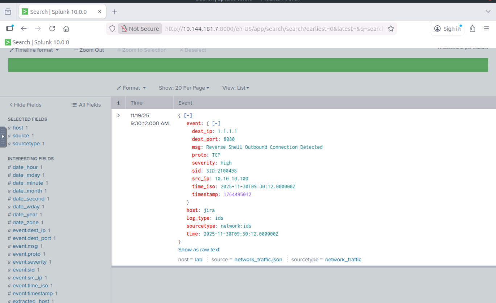
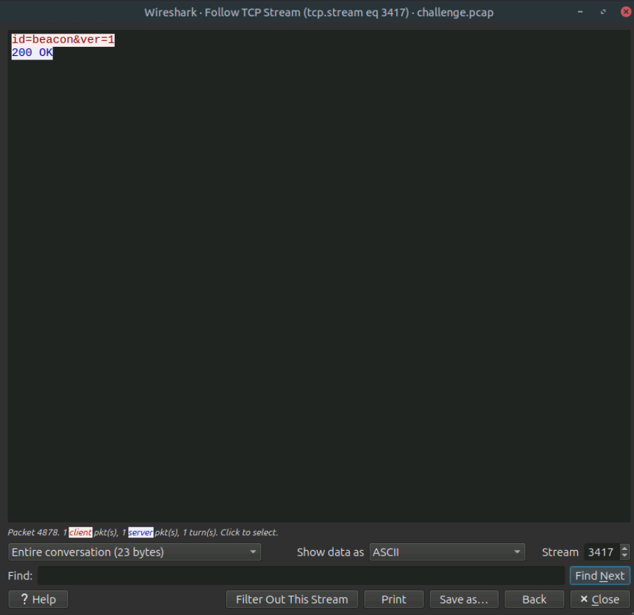
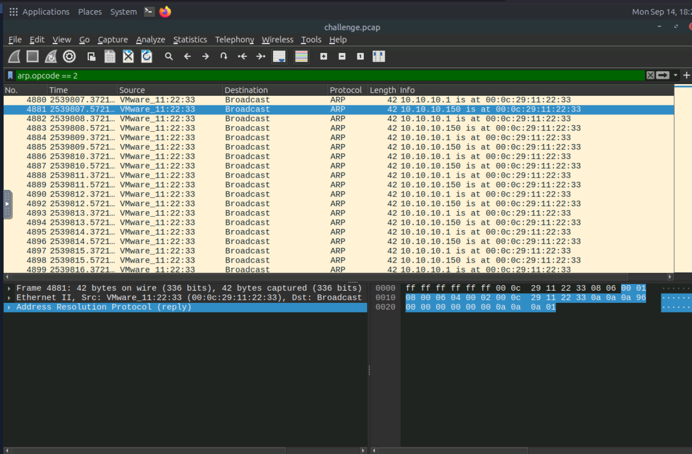
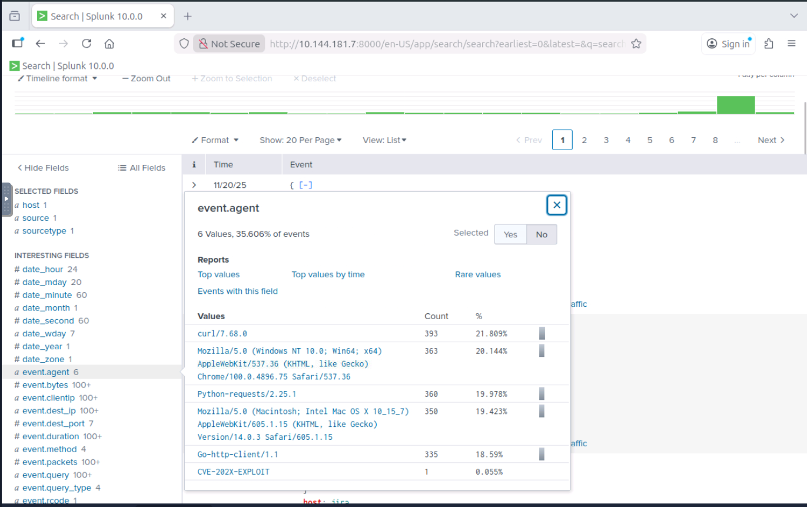
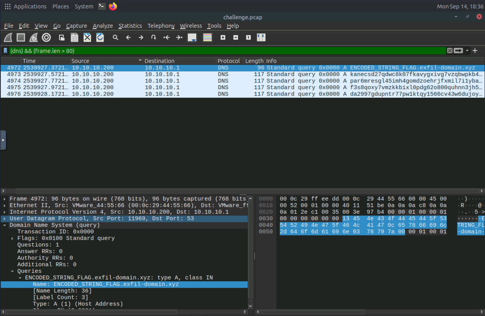
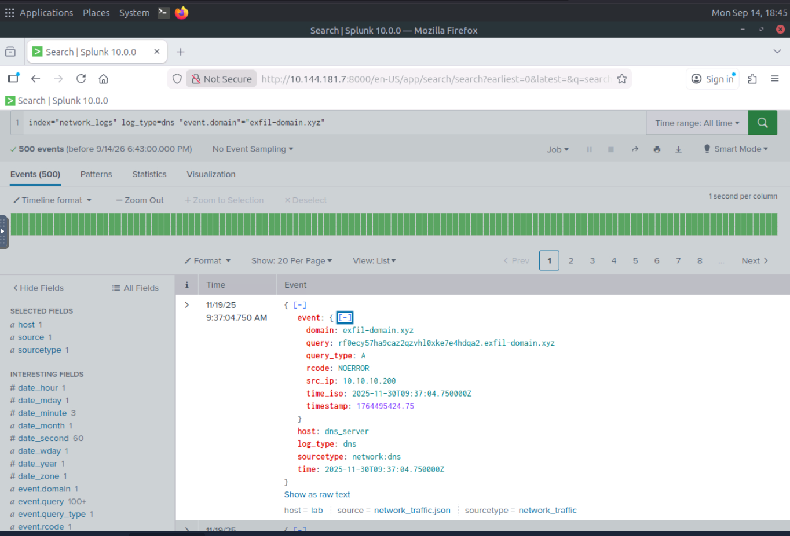

# The Crown Jewel — Reverse Shell, ARP Spoofing & DNS Exfiltration

**Environment:** Authorized TryHackMe training lab  
**Tools:** Splunk, Wireshark  
**Focus:** Network alert validation, MITM behavior, credential exposure, suspicious HTTP and DNS tunneling indicators

## Executive summary
A critical **Reverse Shell Outbound Connection Detected** alert triggered an investigation of traffic involving sensitive internal services. The evidence identified outbound communication with a suspected C2 endpoint, gateway impersonation via ARP replies, an unusual HTTP User-Agent reaching Jira, an HTTP POST containing exposed credentials, and high-volume high-entropy DNS lookups suggesting data exfiltration.

These findings are from a controlled lab. Individual events establish specific observed behaviors; the evidence summarized here does **not** by itself prove that each behavior was carried out by one actor or that all attempted exfiltration succeeded.

## Investigation and pivots

### 1. Suspicious outbound session
A network pivot from host `10.10.10.100` to `1.1.1.1:8080` showed a conversation containing `id=beacon&ver=1` and an HTTP `200 OK` response. This supported the outbound-beacon/reverse-shell alert and justified additional endpoint and network triage. Note: `1.1.1.1` is a well-known public resolver address outside this lab; **do not operationalize it as a globally malicious IOC**.




*Figure 1. The IDS event identifies the internal host, destination port, and reverse-shell alert signature.*




*Figure 2. The TCP stream contains the beacon marker and a 200 OK response.*

### 2. ARP impersonation / interception risk
Traffic analysis identified MAC `00:0c:29:11:22:33` claiming the gateway IP `10.10.10.1` and also IP `10.10.10.150`. The lab investigation counted approximately **90 suspicious ARP replies** across both impersonation directions. This is consistent with an ARP poisoning / man-in-the-middle attempt.




*Figure 3. The filtered packet list contains alternating ARP claims for the gateway and the second internal IP.*

### 3. Suspicious application access
An HTTP request to Jira contained the distinctive User-Agent string `CVE-202X-EXPLOIT`. This is an investigation lead indicating unusual tooling rather than sufficient proof on its own that exploitation succeeded.




*Figure 4. Splunk User-Agent values expose CVE-202X-EXPLOIT as an application-access outlier.*

### 4. Exposed login material
A plaintext HTTP POST to `internal.login.local/login.php` contained credential fields for `dev_user`. The password value is **redacted** from this public report. This illustrates the interception and exposure risks of unencrypted credential submission. The original stream screenshot is omitted because it exposes the password.

### 5. DNS-based suspected exfiltration
Splunk and packet analysis found approximately **500 DNS events** associated with `exfil-domain.xyz`, with numerous long/high-entropy subdomains originating from `10.10.10.200`. This strongly suggests DNS tunneling or encoded-data transfer. DNS queries alone do not establish the full content or final receipt of exfiltrated data.

A useful initial triage filter was:

```wireshark
dns && frame.len > 80
```

This is a heuristic to reduce noise, **not proof of exfiltration**. After identifying the domain, a precise filter is more defensible:

```wireshark
dns.qry.name contains "exfil-domain.xyz"
```




*Figure 5. Wireshark exposes long DNS queries to exfil-domain.xyz after the initial size-based triage filter.*




*Figure 6. Splunk correlates 500 DNS events for the suspicious domain; query volume and pattern support the hypothesis without proving data receipt.*

## Selected evidence and interpretation

| Evidence | Interpretation |
| --- | --- |
| `10.10.10.100 → 1.1.1.1:8080`, beacon marker | Suspicious outbound communication in the lab |
| ARP replies claiming gateway `10.10.10.1` | Gateway impersonation / MITM indicators |
| `00:0c:29:11:22:33` | MAC implicated in ARP anomalies |
| Jira User-Agent `CVE-202X-EXPLOIT` | Potential exploit tooling |
| HTTP POST to `internal.login.local/login.php` | Cleartext credential exposure |
| DNS lookups to `exfil-domain.xyz` | Suspected DNS exfiltration |

## Suggested MITRE ATT&CK mappings

- **T1557.002 — ARP Cache Poisoning:** forged ARP advertisements.
- **T1071.001 — Web Protocols:** suspicious HTTP beacon-like traffic.
- **T1048.003 — Exfiltration Over Unencrypted Non-C2 Protocol:** candidate mapping for DNS-based data transfer; confirm against full telemetry.
- **T1040 — Network Sniffing:** plausible interception objective, not independently proven solely by the ARP events.

## Response recommendations
1. Isolate the compromised hosts and preserve PCAP plus Splunk logs.
2. Investigate anomalous ARP mappings on the local network and enable protections such as Dynamic ARP Inspection where supported.
3. Remove plaintext credential submission and rotate credentials exposed in the HTTP POST.
4. Inspect suspicious Jira requests and associated authentication/activity logs.
5. Review DNS query volume, entropy, and subdomain patterns; block confirmed attacker-controlled destinations.
6. Correlate hosts and timelines before combining alerts into a single confirmed intrusion narrative.

## Analyst reflection
The investigation required moving from one critical alert to multiple corroborating network sources. The key lesson was to distinguish an **analytical filter** from evidence: large DNS frames are a good lead, but the destination and query pattern provide the actual justification.

