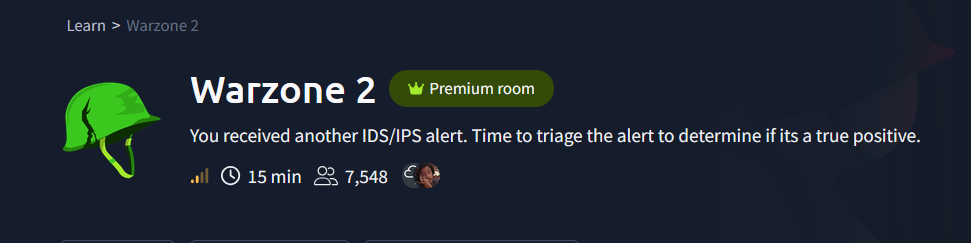

# Warzone 2 — Network IDS Alert Triage

**Environment:** Authorized TryHackMe network-analysis lab  
**Scope:** Alert classification and investigative methodology  
**Evidence status:** Completed training investigation; detailed packet-level findings were not retained in the available investigation notes.

## Summary
This exercise involved reviewing network-monitoring alerts and separating alert signatures from confirmed malicious activity. The examined categories included:

- Miscellaneous activity
- Network Trojan Detected
- Potential Corporate Privacy Violation

These are **alert labels**, not automatically confirmed threat classifications. The case is included as a compact triage exercise rather than an end-to-end intrusion report.

## Retained scenario context

*Figure 1. Original Warzone 2 room context. This image identifies the exercise; it is not an IDS event or evidence of malicious traffic.*

The shared investigation discussion retained this context image but no packet-level evidence screenshots for this case. The scope and limitations below therefore remain unchanged.

## Triage workflow
1. Inventory alerts by signature, severity, source/destination and timestamp.
2. Group alerts into conversations and investigate temporal clusters.
3. Inspect suspicious protocol transactions or streams in Wireshark/Brim.
4. Check whether independent network evidence corroborates the signature.
5. State confidence and open questions; escalate only on validated evidence.

## What this demonstrates
- A repeatable workflow for validating IDS alerts.
- Differentiating detection terminology from actual attacker behavior.
- Documenting evidence gaps rather than inventing IOCs or conclusions.

## Future evidence needed
To elevate this exercise to a flagship report, add the original alert screenshots, relevant PCAP pivots, and confirmed endpoint/destination details.

**Scope note:** No unverified IP addresses, payload claims or attack timeline have been invented for this report.

